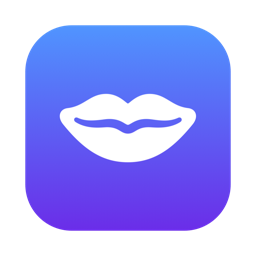
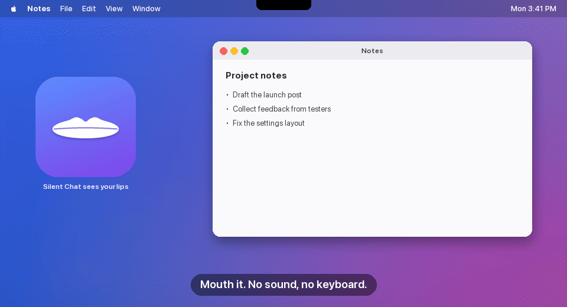
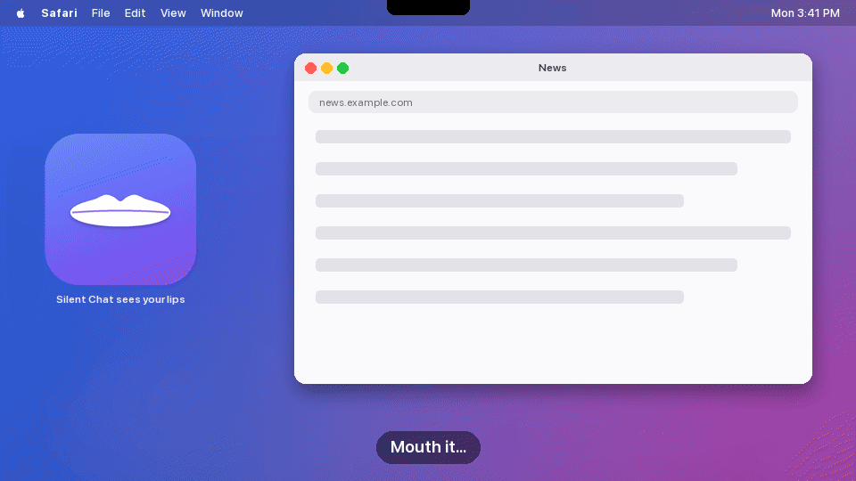
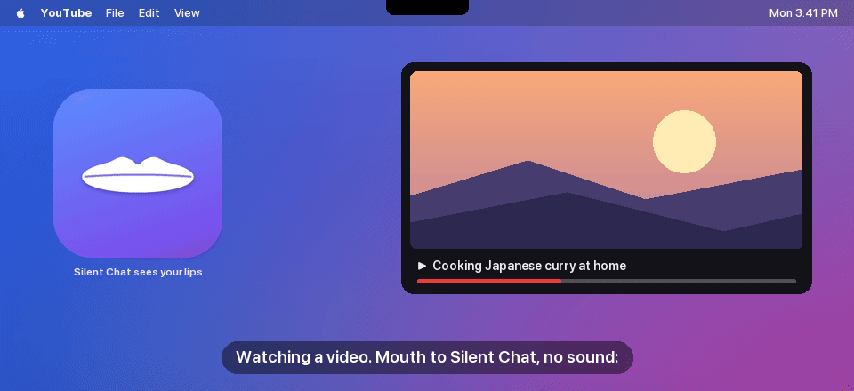
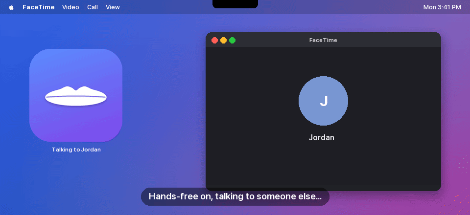
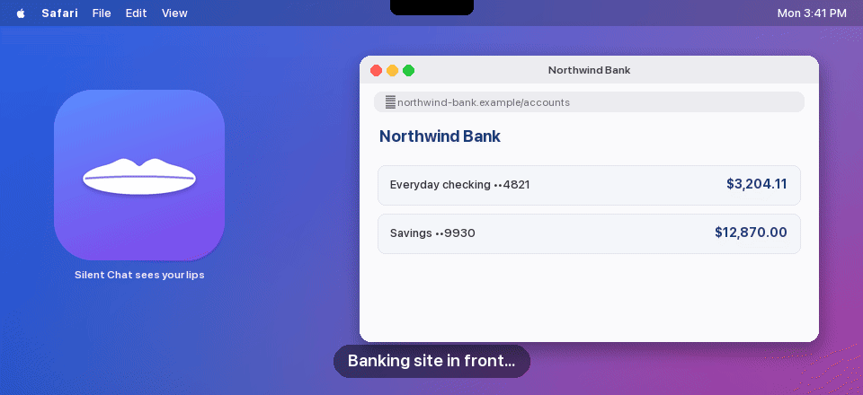
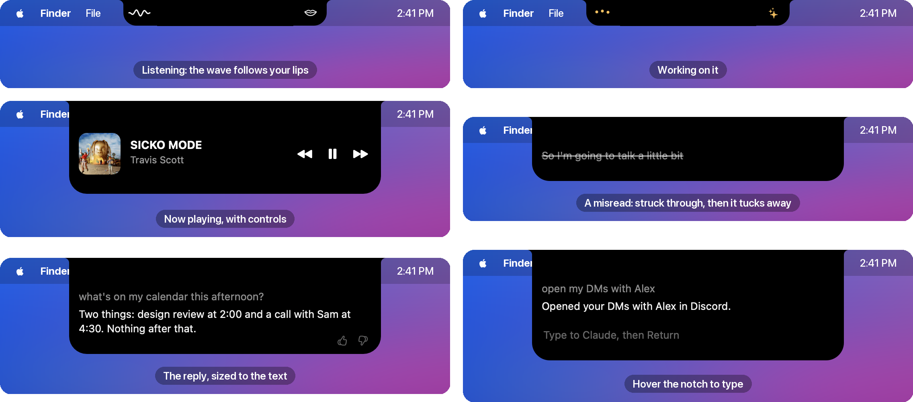
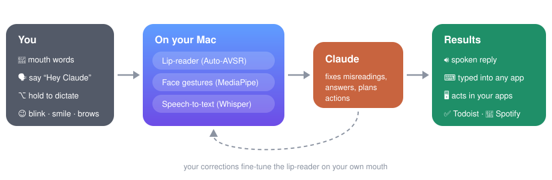
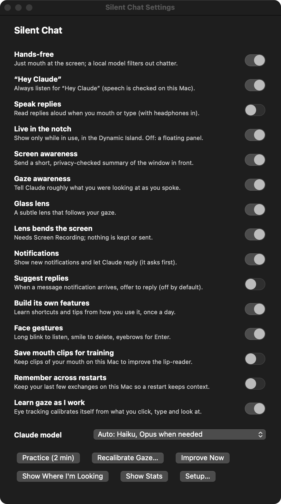

<p align="center">
  
</p>

<h1 align="center">Silent Chat</h1>

<p align="center">
  <b>Talk to Claude on your Mac without making a sound.</b><br>
  Mouth words at your camera, say “Hey Claude”, or just start talking. It lives in your MacBook's notch.
</p>

> [!CAUTION]
> **Privacy & security: read before installing.** Silent Chat is an experimental research project, not a reviewed
> product. To work it needs your **camera**, **microphone**, **Accessibility** (it can click, type and act in any app
> as you), **Input Monitoring** and, optionally, **Screen Recording**. Clips of your mouth, logs and settings are
> stored unencrypted in `data/` on your Mac. What you say or type, a privacy-filtered summary of the window in front
> and what Claude reads on screen are sent to Anthropic through your Claude Code account. The privacy check is best
> effort and can miss things: turn off screen and gaze awareness in Settings when sensitive information is on screen,
> and review the code before you trust it with your accounts. The lip-reading model is for research and
> non-commercial use only.

<p align="center">
  
</p>
<p align="center"><sub>Illustrated: the island is the real app's, rendered frame by frame; the mouth is animated, and the
apps, names and messages are made up.</sub></p>

## What it does

|  |  |
|---|---|
| 👄 **Silent speech** | A lip-reading model on your Mac turns mouthed words into text, and Claude fixes what it misreads. |
| 🏝️ **Lives in the notch** | A Dynamic Island: the notch widens while it hears you or works, drops down with the reply, then tucks away. Hover over it to type. |
| 🙌 **Hands-free** | Just start mouthing while you face the screen. A small model on your Mac weeds out chatter and misreads, so Claude only gets real requests. |
| 🗣️ **“Hey Claude”** | Talk out loud anytime. It answers out loud only when you have headphones in, never over a video, and turns your music down while it talks. |
| ⌨️ **Dictate anywhere** | Hold <kbd>⌥</kbd> in any app, speak or mouth, let go: it's typed where your cursor is. |
| 🖥️ **Uses your apps** | Opens chats, drafts messages, arranges windows, runs Todoist and Spotify (in the background). It asks before sending, deleting or buying. |
| 👀 **Knows your screen** | Each message carries a short summary of the window in front, so “what is this?” or “press Send” needs no extra look. |
| 🔒 **Keeps private things private** | A check on your Mac holds back banking, health, password and ID windows, and blanks card numbers, codes and keys, before anything reaches Claude. |
| 🎯 **Knows where you look** | Eye tracking with no calibration step: it teaches itself from what you click, type and look at, steadied by your AirPods. It tells Claude what you were looking at as you spoke, with a subtle glass lens showing where. |
| ⚡ **Instant commands** | “Pause”, “next song”, “open Discord”, a button's name or a saved shortcut runs in a fraction of a second, with no model. |
| 🌱 **Builds its own features** | Learns shortcuts and per-app tips from how you use it, tweaks the ones you use, and removes ones you haven't used for 7 days. |
| 🔔 **Notifications** | New ones drop down from the notch; say “reply …” and Claude drafts it, then asks. |
| 🙂 **Nod or shake** | Answer Claude's yes/no questions with your head, tracked by your AirPods when they're in. |
| 📈 **Learns you** | Fine-tunes the lip-reader on clips of your own mouth, with a 2-minute practice mode to speed it up. Names and labels on your screen are favoured when it reads your lips. |
| 👍 **Rate replies** | Thumbs up or down in the island; `/stats` shows how it's doing for you (corrections, speed, false starts). |
| 💸 **Easy on your plan** | Everyday commands, hands-free filtering and the privacy check run on your Mac. Haiku answers the rest, and only hard requests go to Opus. |
| 🪶 **Light** | About 2 GB when idle: big models load only when needed, and the camera turns off when you walk away. |

## See it

**Two apps, side by side, in one sentence.**

<p align="center"></p>

**Music without leaving your video.** It finds the song with your Spotify account and plays it in the background.

<p align="center"></p>

**Hands-free that knows when you're not talking to it.** A small model on your Mac crosses out chatter.

<p align="center"></p>

**Private windows stay private.** A check on your Mac keeps banking, health and password screens from Claude.

<p align="center"></p>

<sub>Album artwork © its owners, shown as Spotify displays it. All other apps, names and messages are made up.
`docs/gifs/make_gifs.py` regenerates these.</sub>

<p align="center">
  
</p>

## How it works

<p align="center"></p>

## Install

Needs an Apple Silicon Mac (macOS 14+), [Claude Code](https://claude.com/claude-code) signed in with a claude.ai plan,
and `brew install uv ffmpeg`.

```bash
git clone https://github.com/Input-Labs-HQ/silent-chat && cd silent-chat && ./setup.command
```

Setup downloads the models (~2.5 GB) and puts **Silent Chat** in your menu bar, opening at login. The small local
model (~1.8 GB, for hands-free and the privacy check) downloads the first time it's needed. On first start, a setup
window lists the permissions it needs, with a live check mark and a button to each System Settings page. Allow Camera, Accessibility and Input Monitoring when macOS asks, then tap <kbd>\\</kbd>
to turn the camera on.

## Controls

| Do this | To |
|---|---|
| Tap <kbd>\\</kbd> | Turn the camera on or off (double-tap types a backslash) |
| Face the screen and mouth | Talk to Claude hands-free (HANDS-FREE in the menu) |
| Hold <kbd>⌥</kbd> and mouth or speak | Talk to Claude, or dictate into the app in front |
| Say “Hey Claude, …” | Talk out loud |
| Hover over the notch | See the conversation and type |
| Look up at the notch | See the conversation again |
| Click the island · press Esc | More history · put it away |
| Long blink · smile · raise eyebrows | Listen · delete a word · Enter |
| Nod · shake your head | Yes · no, when Claude asks |
| Tap <kbd>\\</kbd> while Claude is working | Stop it |
| Menu bar > Settings… | Every switch in one place |

<p align="center"></p>

## Privacy

Lip-reading, face and eye tracking, the wake word, speech-to-text, the hands-free model and the privacy check run
on your Mac. Clips of your mouth stay in `data/` and
are never uploaded. Eye tracking calibrates itself from where you click, type and look; all it keeps for that is
numbers about your eyes and head with a screen point, also in `data/` (no pictures, no keys, nothing on screen).
Claude only gets text: what you said or typed, a short, privacy-checked summary of the window in front
(SCREEN in the menu turns it off), notifications from the last few minutes (never codes or passwords), and what it
reads on screen when you ask it to act. The glass lens bends a small patch of screen under your gaze on the fly;
that patch is never kept or sent.

---

[Full guide](docs/GUIDE.md) · [Third-party code and models](THIRD_PARTY.md) (the lip-reading weights are for research and non-commercial use only)
