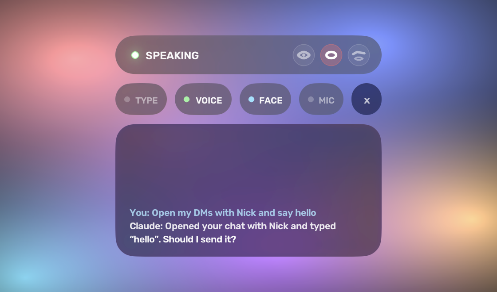

<p align="center">
  
</p>

<h1 align="center">Silent Chat</h1>

<p align="center">
  <b>Talk to Claude on your Mac without making a sound.</b><br>
  Mouth words at your camera, say “Hey Claude”, or hold <kbd>⌥</kbd> to dictate into any app.
</p>

<p align="center">
  
</p>

## What it does

|  |  |
|---|---|
| 👄 **Silent speech** | A lip-reading model on your Mac turns mouthed words into text, and Claude fixes what it misreads. |
| 🗣️ **“Hey Claude”** | Talk out loud anytime, even with the overlay hidden. |
| ⌨️ **Dictate anywhere** | Hold <kbd>⌥</kbd> in any app, speak or mouth, let go: it's typed where your cursor is. |
| 🖥️ **Uses your apps** | Opens chats, drafts messages, arranges windows, runs Todoist and Spotify. It asks before sending, deleting or buying. |
| 😉 **Face gestures** | Long blink to listen, smile to delete words, raise your eyebrows to press Enter. |
| 📈 **Learns you** | Fine-tunes the lip-reader on clips of your own mouth. |

## How it works

<p align="center"></p>

## Install

Needs an Apple Silicon Mac (macOS 14+), [Claude Code](https://claude.com/claude-code) signed in with a claude.ai plan,
and `brew install uv ffmpeg`.

```bash
git clone https://github.com/justbenzo/silent-chat && cd silent-chat && ./setup.command
```

Setup downloads the models (~2.5 GB) and puts **Silent Chat** in your menu bar, opening at login. Allow Camera,
Accessibility and Input Monitoring when macOS asks, then tap <kbd>\\</kbd>.

## Controls

| Do this | To |
|---|---|
| Tap <kbd>\\</kbd> | Show or hide (double-tap types a backslash) |
| Hold <kbd>⌥</kbd> and mouth | Talk to Claude, or dictate into the app in front when hidden |
| Say “Hey Claude, …” | Talk out loud |
| Long blink · smile · raise eyebrows | Listen · delete a word · Enter |
| Tap <kbd>\\</kbd> while Claude is working | Stop it |

## Privacy

Lip-reading, face tracking, the wake word and speech-to-text run on your Mac. Clips of your mouth stay in `data/` and
are never uploaded. Claude only gets text: what you said or typed, and what it reads on screen when you ask it to act.

---

[Full guide](docs/GUIDE.md) · [Third-party code and models](THIRD_PARTY.md) (the lip-reading weights are for research and non-commercial use only)
