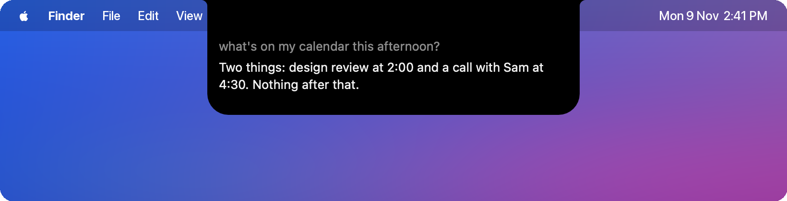

<p align="center">
  
</p>

<h1 align="center">Silent Chat</h1>

<p align="center">
  <b>Talk to Claude on your Mac without making a sound.</b><br>
  Mouth words at your camera, say “Hey Claude”, or just start talking. It lives in your MacBook's notch.
</p>

<p align="center">
  
</p>

## What it does

|  |  |
|---|---|
| 👄 **Silent speech** | A lip-reading model on your Mac turns mouthed words into text, and Claude fixes what it misreads. |
| 🏝️ **Lives in the notch** | A Dynamic Island: the notch widens while it hears you or works, drops down with the reply, then tucks away. Hover over it to type. |
| 🙌 **Hands-free** | Just start mouthing while you face the screen. A small model on your Mac weeds out chatter and misreads, so Claude only gets real requests. |
| 🗣️ **“Hey Claude”** | Talk out loud anytime. It answers out loud only when you have headphones in, never over a video, and turns your music down while it talks. |
| ⌨️ **Dictate anywhere** | Hold <kbd>⌥</kbd> in any app, speak or mouth, let go: it's typed where your cursor is. |
| 🖥️ **Uses your apps** | Opens chats, drafts messages, arranges windows, runs Todoist and Spotify (in the background). It asks before sending, deleting or buying. |
| 👀 **Knows your screen** | Each message carries a short summary of the window in front, so “what is this?” or “press Send” needs no extra look. |
| 🎯 **Knows where you look** | Eye tracking (steadied by your AirPods) tells Claude what you were looking at as you spoke, with a subtle glass lens showing where. |
| ⚡ **Instant commands** | “Pause”, “next song”, “open Discord”, a button's name or a saved shortcut runs in a fraction of a second, with no model. |
| 🌱 **Builds its own features** | Learns shortcuts and per-app tips from how you use it, tweaks the ones you use, and removes ones you haven't used for 7 days. |
| 🔔 **Notifications** | New ones drop down from the notch; say “reply …” and Claude drafts it, then asks. |
| 🙂 **Nod or shake** | Answer Claude's yes/no questions with your head, tracked by your AirPods when they're in. |
| 📈 **Learns you** | Fine-tunes the lip-reader on clips of your own mouth. |
| 💸 **Easy on your plan** | Everyday commands and hands-free filtering run on your Mac. Haiku answers the rest, and only hard requests go to Opus. |

<p align="center">
  
</p>

## How it works

<p align="center"></p>

## Install

Needs an Apple Silicon Mac (macOS 14+), [Claude Code](https://claude.com/claude-code) signed in with a claude.ai plan,
and `brew install uv ffmpeg`.

```bash
git clone https://github.com/justbenzo/silent-chat && cd silent-chat && ./setup.command
```

Setup downloads the models (~2.5 GB) and puts **Silent Chat** in your menu bar, opening at login. The small
hands-free model (~1.8 GB) downloads the first time you turn HANDS-FREE on. Allow Camera, Accessibility and Input Monitoring when macOS asks, then tap <kbd>\\</kbd>
to turn the camera on.

## Controls

| Do this | To |
|---|---|
| Tap <kbd>\\</kbd> | Turn the camera on or off (double-tap types a backslash) |
| Face the screen and mouth | Talk to Claude hands-free (HANDS-FREE in the menu) |
| Hold <kbd>⌥</kbd> and mouth or speak | Talk to Claude, or dictate into the app in front |
| Say “Hey Claude, …” | Talk out loud |
| Hover over the notch | See the conversation and type |
| Long blink · smile · raise eyebrows | Listen · delete a word · Enter |
| Nod · shake your head | Yes · no, when Claude asks |
| Tap <kbd>\\</kbd> while Claude is working | Stop it |

## Privacy

Lip-reading, face and eye tracking, the wake word, speech-to-text and the hands-free model run on your Mac. Clips of your mouth stay in `data/` and
are never uploaded. Claude only gets text: what you said or typed, a short summary of the window in front
(SCREEN in the menu turns it off), notifications from the last few minutes (never codes or passwords), and what it
reads on screen when you ask it to act. The glass lens bends a small patch of screen under your gaze on the fly;
that patch is never kept or sent.

---

[Full guide](docs/GUIDE.md) · [Third-party code and models](THIRD_PARTY.md) (the lip-reading weights are for research and non-commercial use only)
